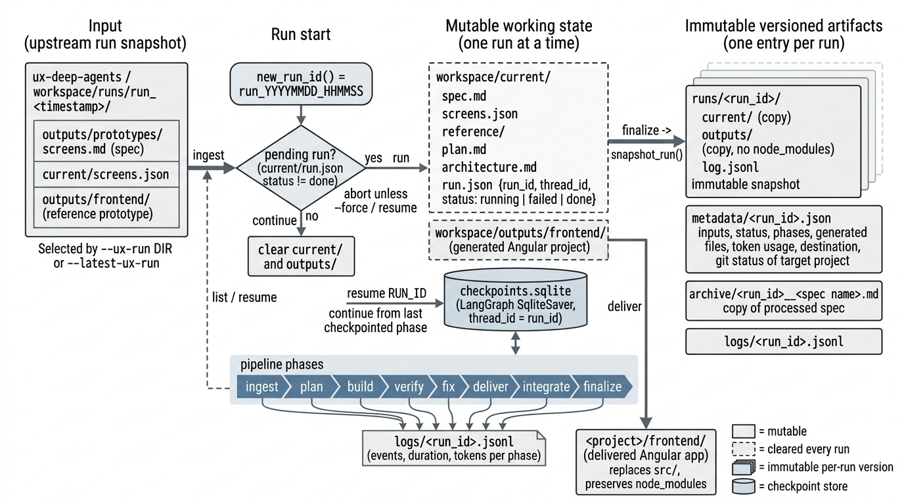

# frontend-builder

Deep Agent (LangChain `deepagents`) orchestrated by **LangGraph** with three commands over a target project (`--project DIR`):

1. `describe`: reads the project's backend and writes the `.md` that explains the product and its flows so a designer can
   prototype the screens (the input of the `ux-deep-agents` microservice, via the "choose file" of its web UI).
2. `build`: builds the **Angular 22** application from the front-end prototype that `ux-deep-agents` produced:
   `outputs/prototypes/screens.md` + `screens.json` (what each screen does) and the **HTML of the screens approved in Stitch**
   (`outputs/stitch/<slug>/<id>.html`, the visual source: layout, Tailwind classes, color theme and fonts). Writes to
   `<project>/frontend/` and, with `--project`, goes on to the integration.
3. `integrate`: adapts backend and front-end to work together (CORS, serving the build, `environment.ts`, API contract,
   README) and runs the project checks (black, pytest, `ngc` + `ng build`).

Every agent uses `openai:gpt-6-luna` (`app/models.py`; `MODEL_<AGENT>` overrides).

## Pipeline

```
describe:  ingest_project -> describe_phase (backend_analyst) -> finalize_describe
build:     ingest -> plan_phase -> review_architecture --(approved | --auto-approve)--> build_phase -> verify_frontend --(errors)--> fix_phase
                              ^          '-- revise_architecture <-- (feedback, up to MAX_REVIEW_ROUNDS)          '--(ok)--> deliver
                                                                                        -> [integrate_phase -> verify_integration] -> finalize
integrate: ingest_integrate -> integrate_phase (integrator) -> verify_integration --(errors, 1 round)--> integrate_fix -> finalize
```

| Phase | Who | What it does |
|---|---|---|
| `ingest` | pipeline | copies the spec and `screens.json`, slices the spec into `current/screens/<id>.md` + `_common.md` (each `angular_coder` reads only its own screens), copies `current/stitch/<id>.html`, converts the Stitch Tailwind v3 config into a v4 `@theme` block in `src/styles.css` and brings the fonts into `index.html` (`app/theme.py`); with `--project`, generates `current/openapi.json`, `current/contract.md` and `src/app/core/models.ts` from the backend (`app/openapi.py`, `app/contract.py`) |
| `plan_phase` | orchestrator -> `architect` | `current/plan.md`, `current/architecture.md` (screen -> route -> file, Stitch design tokens and layout, shared, models, services), app core (`app.ts`, `app.routes.ts`, `core/**`, `shared/**`) |
| `review_architecture` | human reviewer | pauses (`interrupt()`) with `architecture.md` and `plan.md`: approving continues; feedback is written to `current/feedback.md` and goes back to the `architect` (`revise_architecture`, up to `MAX_REVIEW_ROUNDS`, default 3; then continues with a warning). The terminal asks; the API leaves the run `paused` until `POST /runs/{id}/decision`; `--auto-approve` skips it |
| `build_phase` | orchestrator -> N x `angular_coder` in parallel | one batch of screens per `task()`; each screen converts the Stitch HTML into `src/app/screens/<id>/<id>.ts` (structure and classes preserved, content becomes signals and `@for`, loading/empty/error states); then `README.md` |
| `verify_frontend` | pipeline | `ngc --noEmit` (strictTemplates) in `workspace/.angular_cache` |
| `fix_phase` | orchestrator -> `angular_coder` | fixes only the files reported by `ngc` |
| `deliver` | pipeline | `ng build --configuration production` and copy to `<project>/frontend` (or `FRONTEND_DEST`) |
| `integrate_phase` | orchestrator -> `integrator` | CORS and `/app` in FastAPI, `useMocks: false`, front-end contract = backend, README; `project_check` until it passes |
| `verify_integration` | pipeline | `contract` (client routes exist in openapi.json), `uvx black`, backend `pytest` and `ngc` + `ng build` (`PROJECT_TEST_CMD`/`PROJECT_FORMAT_CMD` override) |
| `describe_phase` | orchestrator -> `backend_analyst` | `outputs/brief/<slug>-descricao.md` with the 10 sections of the `ux-brief` skill; copy in `inputs/` and, with `--to-ux`, in `UX_INPUTS_DIR` |
| `finalize` | pipeline | snapshot in `runs/<run_id>/`, `metadata/<run_id>.json` (includes the project's `git status`), spec archived |

The target project appears to the agents as `/project/` (`CompositeBackend`); the workspace stays at `/`.

**Tokens-per-minute budget (D12).** All agents share a tokens-per-minute budget (`app/ratelimit.py`, `TPM_BUDGET`, default
1.5M, below OpenAI's 2M/min for Luna): every model call is estimated before it goes out and waits for the 60 s window to have
room, instead of taking a 429 and exhausting the retries with four `angular_coder` in parallel. The waits show up in each
phase's log (`rate_limit_waits`, `rate_limit_waited_s`) and in the metadata. The orchestrator also launches at most
`MAX_PARALLEL_CODERS` (3) batches per message, and each coder reads only the spec section of its own screens. With
`OPENROUTER_API_KEY`, a 429 that still slips through falls back to the same model via OpenRouter.

The base Angular project (package.json with Tailwind v4 compiled in the build via `.postcssrc.json`, angular.json, tsconfig,
main.ts, index.html, `styles.css` with `@import "tailwindcss"` and the Stitch `@theme`, `environments/environment.ts` with
`apiBaseUrl`/`useMocks`, `app.config.ts` with HttpClient and Router in path routing) comes from `app/templates/angular/`; the
agents generate only `src/app/**` and `README.md`. The app runs without a backend (`useMocks: true`) using
`MockJobApplierApi`; `HttpJobApplierApi` follows the contract generated from the backend: on every run with `--project`, the
builder imports the FastAPI app in the project's venv, calls `app.openapi()` and writes `current/openapi.json`,
`current/contract.md` (table of routes, bodies, responses and schemas) and `src/app/core/models.ts` (one interface per
schema; never edited by hand). The integration's `contract` check verifies that every route used in `src/app/core/api/*.ts`
exists in the schema (D2: no hand-copied contract).

## Workspace

| Folder | Use |
|---|---|
| `workspace/inputs/` | `.md` specs to process (or use `--ux-run` / `--latest-ux-run`) |
| `workspace/current/` | current run: `spec.md`, `screens.json`, `stitch/` (approved HTML per screen), `reference/` (previous prototype, optional), `plan.md`, `architecture.md`, `run.json` |
| `workspace/outputs/frontend/` | generated Angular project (cleared on every run) |
| `workspace/logs/` | `<run_id>.jsonl`: events, duration and tokens per phase, `ngc` errors |
| `workspace/metadata/` | `<run_id>.json`: inputs, status, generated files, usage, destination |
| `workspace/skills/` | `angular-app`, `api-contract`, `ux-brief`, `integration` (SKILL.md read by the subagents) |
| `workspace/runs/` | immutable snapshot of each run |
| `workspace/archive/` | copy of the processed spec |
| `workspace/.angular_cache/` | template + `node_modules` for `ngc`/`ng build` |

## Run versioning



The builder feeds on other microservices: the target backend project (`--project`, mounted as `/project/`; for example
`DeepJobFinderAgent` or `deepagents_jobapplier`) and the run snapshot of `ux-deep-agents` (`screens.md`, `screens.json` and
the HTML approved in Stitch). `describe` closes the first end of the cycle, producing the brief the designer approves in
`ux-deep-agents`; `deliver` + `integrate` close the last one, writing the integrated Angular back into the target project.

Every execution, started from the CLI, the HTTP API (`POST /runs`) or Docker, gets a `run_id` (`run_YYYYMMDD_HHMMSS`).
Mutable state lives in `current/` and `outputs/`, cleared on every run; the SQLite checkpointer (`thread_id = run_id`) allows
`resume`. In `finalize`, `snapshot_run()` freezes `current/`, `outputs/` and the log into `runs/<run_id>/`, writes
`metadata/<run_id>.json` and archives the spec in `archive/`. A pending run (`current/run.json` with a status other than
`done`) blocks new runs without `--force` (HTTP 409 in the API).

## How to run

Three paths, all with the same commands (`describe`, `build`, `integrate`, `ask`, `list`, `resume`):
the **terminal** (CLI, best for following the phases in the console), the **web** (HTTP API, to start runs and query status
from another system) and **Docker** (image with everything installed, to run the same way on any machine or server).

### Prerequisites

```bash
uv sync                                   # Python 3.12 and locked dependencies (uv.lock)
cp .env.example .env                      # OPENAI_API_KEY required; OPENROUTER_API_KEY (429 fallback) and LangSmith optional
node -v                                   # Node 22+ and npm, used by ngc and ng build (not needed in Docker)
P=~/Codes/deepagents_jobapplier           # target project (FastAPI backend); the Angular app goes to $P/frontend
```

The full flow is: `describe` produces the brief -> you upload the `.md` in the "choose file" of `ux-deep-agents` and approve
the screens in Stitch -> `build` generates the Angular app from that run and, with `--project`, integrates it with the backend.

### 1. Terminal (CLI)

```bash
uv run python -m app.main describe --project $P --to-ux        # brief for the designer (+ copy into the ux-deep-agents inputs)
uv run python -m app.main build --latest-ux-run --project $P   # Angular in $P/frontend + integration with the backend
#   -> after the architect, the terminal shows current/architecture.md and asks: [s] approve | [n] send corrections back
uv run python -m app.main build --latest-ux-run --project $P --auto-approve   # without the pause (CI, scripts)
uv run python -m app.main build --ux-run "~/UX Project/ux-deep-agents/workspace/runs/run_20261030_205257" --project $P
uv run python -m app.main build spec.md --screens screens.json --stitch stitch-html/ --dest /other/destination
uv run python -m app.main integrate --project $P               # integration only, over an already delivered front-end
uv run python -m app.main ask "Which screens did the last run generate?" --project $P   # ask the agent (read-only)
uv run python -m app.main list                                 # runs and status
uv run python -m app.main resume [RUN_ID]                      # resumes an interrupted run or one paused at the review
```

The terminal shows each phase and each subagent (`-> architect iniciou`, `<- angular_coder terminou (120s)`), the checks
(`ngc`, `ng build`, `black`, `pytest`) and, at the end, duration, tokens, destination and the project's `git status`. One run
at a time: with a `running` or `paused` run in `workspace/current/run.json`, use `resume`, `list` or `--force` (a `failed`
run does not block). The skills in `workspace/skills/` are validated at the start of every run: invalid frontmatter aborts
before spending tokens.

**Architecture review (D3).** The cheap place to fix things is before the code: after the `architect` (~5 min), the build
pauses and shows `current/architecture.md` (screens -> routes -> files, `/shared` components, services, batches). Approving
goes on to the build; sending corrections back writes `current/feedback.md`, the `architect` revises (1 to 2 min) and the
question comes back, up to `MAX_REVIEW_ROUNDS` (3); after that the build continues with a warning and the open items go to
the `angular_coder`s. Closing the terminal halfway leaves the run `paused`; `resume` reopens the question.

### 2. Web (HTTP API)

```bash
uv run python -m app.main serve --port 8010   # Swagger at http://localhost:8010/docs (8000 is usually taken by ux-deep-agents)
```

The same commands become requests; runs execute in the background, one at a time (409 if one is pending and `force` is not set):

```bash
curl -X POST localhost:8010/runs -H 'content-type: application/json' \
  -d '{"mode": "describe", "project": "'$P'", "to_ux": true}'
curl -X POST localhost:8010/runs -H 'content-type: application/json' \
  -d '{"mode": "build", "project": "'$P'"}'        # ux_run optional; without it, the latest UX run; auto_approve skips the review
curl localhost:8010/runs/<run_id>                  # status "paused": the review field carries round, architecture and plan
curl -X POST localhost:8010/runs/<run_id>/decision -H 'content-type: application/json' \
  -d '{"approved": false, "feedback": "put the search screens in one batch"}'   # or {"approved": true}
curl localhost:8010/runs                           # list with status and usage
curl localhost:8010/runs/<run_id>                  # metadata, progress notes, error
curl localhost:8010/runs/<run_id>/events           # the run's jsonl log
curl -X POST localhost:8010/ask -H 'content-type: application/json' \
  -d '{"question": "Did the last run compile? How much did it cost?", "project": "'$P'"}'   # {"response": "..."}
```

`POST /ask` answers synchronously with the deep agent in read-only mode over `metadata/`, `logs/`, `current/`, `outputs/`,
`runs/`, `skills/` and the project; agent errors come back as 500 with the detail. `GET /health` for monitoring.

### 3. Docker

The image ships Python 3.12, `uv`, Node 22 and the Angular cache (template + `node_modules`) pre-installed in
`/opt/angular_cache`, so `ngc` and `ng build` work without network on every run. The workspace, the target project and the
`ux-deep-agents` workspace come in as volumes (`compose.yaml`): `./workspace` at `/app/workspace`, the project at `/target`
and the UX workspace at `/ux` (`TARGET_PROJECT` and `UX_WORKSPACE` override the paths; `BUILDER_PORT` the host port, default 8010).

```bash
docker compose build                                   # or docker pull ghcr.io/guicondor1512-genai-bci/frontend-builder:latest
docker compose up -d                                   # web: API at http://localhost:8010 (Swagger at /docs)
docker compose run --rm builder describe --project /target --to-ux      # terminal inside the container
docker compose run --rm builder build --latest-ux-run --project /target
docker compose run --rm builder integrate --project /target
docker compose run --rm builder ask "Which screens exist?" --project /target
docker compose run --rm builder list
docker compose logs -f builder                         # follow the API
```

Without compose: `docker build -t frontend-builder .` and `docker run --rm -p 8010:8000 --env-file .env -v ./workspace:/app/workspace -v $P:/target -v "$HOME/UX Project/ux-deep-agents/workspace":/ux frontend-builder` (API); any CLI
subcommand at the end of the command runs instead of the API.

During the integration, the target project's tests run inside the container with `UV_PROJECT_ENVIRONMENT=/tmp/target-venv`
(`PROJECT_TEST_CMD` in the image), so the host `.venv` mounted at `/target` is not touched. `ANGULAR_CACHE` points the Angular
cache outside the workspace volume.

### After a run

`cd $P/frontend && npm install && npm start` (http://localhost:4200) with `uv run job-applier-web` on the backend (port 8501,
CORS open for 4200). To serve the build through FastAPI: `npm run build:app` (`ng build --base-href /app/`) and open
http://localhost:8501/app/; the backend returns `index.html` for any route under `/app/` that is not a file, so
`/app/search-setup` and refresh work with path routing (no `#`).
A single Angular generator (D1): in `ux-deep-agents`, `FRONTEND_CODER=0` skips the `frontend_coder`; the Angular app comes
only from here, faithful to the screens approved in Stitch.

### Variables

`OPENAI_API_KEY`, `MODEL`, `MODEL_ARCHITECT`, `MODEL_ANGULAR_CODER`, `MODEL_BACKEND_ANALYST`, `MODEL_INTEGRATOR`, `MODEL_ASK`,
`OPENROUTER_API_KEY` (same model via OpenRouter as fallback on 429/5xx), `TPM_BUDGET`, `MAX_PARALLEL_CODERS`, `MODEL_MAX_RETRIES`, `MAX_FIX_ROUNDS`, `MAX_REVIEW_ROUNDS`, `FRONTEND_CHECK`, `FRONTEND_DEST`, `UX_RUNS_DIR`, `UX_INPUTS_DIR`, `PROJECT_TEST_CMD`,
`PROJECT_FORMAT_CMD`, `PROJECT_CMD_PREFIX` (prefix for the commands run in the project, e.g. `UV_PROJECT_ENVIRONMENT=...`), `OPENAPI_APP`
(FastAPI app to import, default `job_applier.main:app`), `OPENAPI_URL` (fetch the schema from a running server), `BUILDER_WORKSPACE`,
`ANGULAR_CACHE`, LangSmith block.

### Versioning and publishing the image

CI (`.github/workflows/ci.yml`) runs ruff, mypy, pytest and the image build on every PR; on every push to `main` it publishes
`ghcr.io/guicondor1512-genai-bci/frontend-builder` with three tags: the `version` from `pyproject.toml`, `latest` and
`sha-<commit>`, then calls the `DEPLOY_HOOK` webhook (repository secret) with the published tag so the environment pulls the
new image; without the secret, the deploy step is skipped.
To release a version, bump `version` in `pyproject.toml` in the PR. To use the published image, replace `build: .` with
`image: ghcr.io/guicondor1512-genai-bci/frontend-builder:latest` in `compose.yaml` (or `docker pull`).

Manual publishing (requires the `write:packages` scope on the `gh` token):

```bash
gh auth refresh -s write:packages
gh auth token | docker login ghcr.io -u guicondor1512-genAI-BCI --password-stdin
IMAGE=ghcr.io/guicondor1512-genai-bci/frontend-builder
VERSION=$(grep -m1 '^version' pyproject.toml | cut -d '"' -f2)
docker build -t frontend-builder .
docker tag frontend-builder "$IMAGE:$VERSION" && docker tag frontend-builder "$IMAGE:latest"
docker push "$IMAGE:$VERSION" && docker push "$IMAGE:latest"
```

## Tests and lint

```bash
uv run pytest -q                              # graph with a fake agent, no LLM and no npm
TEST_FRONTEND_CHECK=1 uv run pytest -q        # same, with real ngc and ng build
uv run ruff check . && uv run ruff format --check .
uv run --with mypy mypy app                    # types (CI)
```
